# Capsule

[](https://github.com/vorgtrom/capsule-notch/actions/workflows/build.yml)

A little glass capsule on the edge of your Windows screen that keeps an eye on **Claude Code** and **Codex** for you.

https://github.com/user-attachments/assets/390b5032-8688-4078-9ba8-860c0a3ff868

- **Your usage limits at a glance.** One ring per tool, and when each limit resets. Capsule forecasts when you'll
  run out at your current pace, and warns you before you do.
- **Your sessions.** Whether each Claude Code session is working, waiting on you or done, with your last prompt,
  what Claude did last, and how full its context is.
- **Answer without switching apps.** Approve a command, review a file edit line by line, approve a plan or answer a
  question right on the capsule. Codex and local ChatGPT Work command approvals and questions too.
- **Your token history.** A heatmap of tokens per day and model, like Claude Code's `/stats`.
- **The rest of your day**, in one panel: Google Calendar and Tasks, weather, Spotify or YouTube Music with a volume
  slider, a focus timer, clipboard history, screenshots of an area or a whole scrolling webpage, a shelf for files,
  failing GitHub checks, and an Ideas box that saves to Notion.

Every ring can be switched off. Install it with [Scoop](#get-it) or download it from the
[Releases page](https://github.com/vorgtrom/capsule-notch/releases/latest).

| On the screen edge | Hover a ring | Click it |
|:---:|:---:|:---:|
| 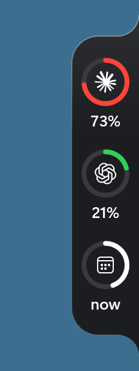 | 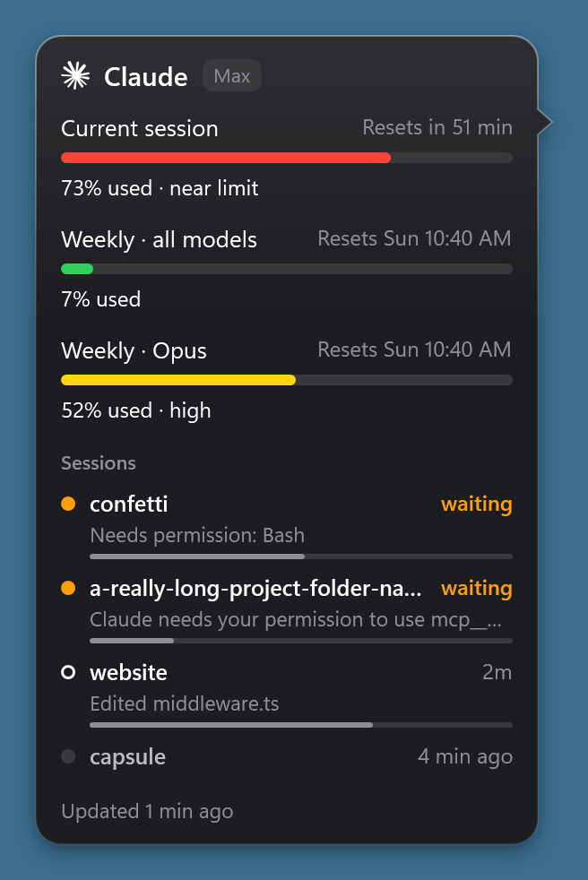 | 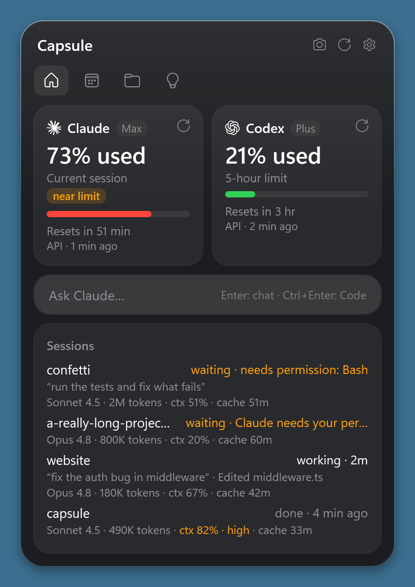 |

*The pictures show the solid look. On Windows 11 the capsule, its cards and the panel are clear glass, with the
windows behind them blurred live. They follow Windows' light or dark mode, and turn solid with **Transparency
effects** off or on Windows 10.*

**Contents:**
[Get it](#get-it) ·
[Use](#use) ·
[Claude and Codex](#claude-and-codex) ·
[Usage history and alerts](#usage-history-and-limit-alerts) ·
[The panel's tiles](#the-panels-tiles) ·
[Privacy](#what-it-reads-and-where-it-connects) ·
[Update](#update) ·
[Uninstall](#uninstall) ·
[Build](#build)

## Get it

You need Windows 10 or 11 (64-bit) with .NET Framework 4.8 or later. Windows 11 and an up-to-date Windows 10
already have it.

**With Scoop** ([scoop.sh](https://scoop.sh)), in PowerShell:

```pwsh
scoop bucket add capsule https://github.com/vorgtrom/scoop-capsule
scoop install capsule/capsule
```

Then start **Capsule** from the Start menu (Scoop Apps → Capsule).

**With winget** (once Microsoft has accepted the package):

```pwsh
winget install vorgtrom.Capsule
```

Then start it with `capsule-notch` in a terminal.

**Or download it:**
1. On the [Releases page](https://github.com/vorgtrom/capsule-notch/releases/latest), download `Capsule-<version>.zip`.
2. Unzip it into a folder that stays, such as `Documents\Capsule`.
3. Start `Capsule.exe`.
   - Capsule isn't code-signed, so Windows may say **Windows protected your PC**. Click **More info**, then **Run
     anyway**. GitHub builds and tests each release from the code in this repo; the zip's SHA-256 is next to it.
   - If your antivirus objects, see [Antivirus](#antivirus).

**Or build it yourself**, with the C# compiler that ships with Windows, so nothing is downloaded and nothing
unsigned from the internet runs:

```powershell
git clone https://github.com/vorgtrom/capsule-notch.git
cd capsule-notch
.\build.cmd
.\bin\Capsule.exe
```

No Git? Click **Code → Download ZIP** on this page, unzip it somewhere that stays, and run `build.cmd` in that
folder. It should end with `Build OK`; then start `bin\Capsule.exe`.

What changed in each version is in [CHANGELOG.md](CHANGELOG.md), and on each release's page.

### Antivirus

Behaviour-based antivirus may freeze or remove Capsule. It's a new, unsigned program that reads the Claude and
Codex sign-in files, keeps an encrypted Notion secret and Google sign-in, and goes online, which is also what
token-stealing malware does. Norton did this on the first run.

If it happens to you:
1. Restore `Capsule.exe` from the antivirus's history.
2. Exclude the folder Capsule runs from: the one you unzipped it into, or `bin` if you built it. In Norton:
   **Settings → Antivirus → Scans and Risks → Items to Exclude from Auto-Protect, Script Control, SONAR and Download
   Intelligence Detection**.

Only exclusions survive updates and rebuilds. All the source is in this repo, so you can check what it does first.

## Use

On first run, Capsule asks whether to start with Windows. **No** is the default; change it in the menu any time.

- **Hover** a ring for its details.
- **Click** the capsule for the panel. Its ⟳ buttons check again now. If Claude needs signing in, its tile has a
  **Sign in** button, which runs `claude auth login`.
- **Ctrl+Alt+N** from any app opens the panel with the cursor in the Ideas box. Type, press Enter, and it's saved.
  When Claude or Codex is waiting on you, the same shortcut opens the request instead (see
  [the keyboard](#answer-with-the-keyboard)). Change the shortcut in the panel's Settings (⚙). It isn't
  Ctrl+Alt+Space, because the Claude desktop app uses that.
- **Ask Claude**, the box under the Claude and Codex tiles, opens the Claude app with your prompt filled in: **Enter**
  for a new chat, **Ctrl+Enter** for a new Claude Code session, **Shift+Enter** for a new line. The app shows the
  prompt for you to check and send; Capsule never sends it.
- **Ctrl+Alt+M** mutes or unmutes your microphone in every app at once (change it under **Mute microphone** in
  Settings). While it's muted, the capsule shows a red **Muted** ring. If Windows or another app mutes it, that shows
  too.
- **Esc** closes the panel, and so does switching apps. Settings and open calendar forms stay open, so you can copy
  values from another app. **Back** leaves Settings and clears unsaved secret fields.
- **Drag** the capsule to move it. It snaps to the left or right edge of the screen you drop it on.
- **Right-click** the capsule or the tray icon for the menu. **Left-click** the tray icon to hide or show the capsule.
- It hides while a fullscreen app covers its screen, such as a game, a video or a presentation.
- **News beside the capsule.** A song that starts, text copied from the screen, or the mic muted shows for a moment in
  a small pill that grows out of its ring, instead of a Windows notification. Limit and session alerts stay Windows
  notifications. Nothing shows over a request card or the open panel, nor while you focus quietly.
- **Slim capsule** (Settings, off by default) turns the capsule into a thin line on the screen edge until you point at
  it. It stays full while something waits on you, the mic is muted, or its card or the panel is open.
- **Click a usage or session alert** to open the panel.

**Settings (⚙ in the panel):**
- **Your rings.** A switch each for Claude, Codex, Calendar, Music and Focus. A ring that's off leaves the capsule and
  the panel, and Capsule stops its work: no checks, alerts or sounds for it. A request that ring would hold goes
  straight to the Claude or Codex app. One ring always stays on.
- **Open panel with** puts Calendar, Weather, Clipboard or Needs you first. A waiting request puts Needs you first
  whatever you chose.
- The panel scrolls when it's taller than the screen; its header stays put.

**The menu** has **Refresh now**, **Capture...**, **Show notch**, Connect / Disconnect for Claude Code and Codex,
**Start with Windows**, **Open data folder**, **Limit alerts**, **Sounds**, **Start focus**, **Check for updates**
(downloaded copies) and **Quit Capsule**.

## Claude and Codex

### Connect

- **Claude Code:** choose **Connect to Claude Code** in the menu. Capsule copies its hook to
  `%USERPROFILE%\.capsule\bin`, saves a backup of `~/.claude/settings.json`, and registers the hook there. New
  sessions report in from then on; in the desktop app, running ones do too. If you connected with an older Capsule,
  the menu says **Reconnect to Claude Code**: choose it once.
- **Codex and local ChatGPT Work:** see [below](#codex-and-local-chatgpt-work).
- **Is it working?** Under each Connect item, the menu says when Capsule last heard from it: "Last event 3 min ago"
  for Claude Code, "Last request 2 h ago" for Codex, or what to do if nothing has arrived yet.
- **Moved Capsule?** Start it from its new folder and the connection updates itself.
- From a terminal: `Capsule.exe --connect` / `--disconnect` (Claude Code) and `--connect-codex` /
  `--disconnect-codex`. They print nothing; the result goes to the log.

### The rings

- **One ring per tool**, showing the limit window you've used most: green under 50%, yellow from 50%, red from 70%.
  The tiles and cards say it in words too: "high" from 50%, "near limit" from 70%.
- **While Claude works**, a small white arc spins inside its ring. Codex's ring spins too while a Codex turn runs.
- **While Claude waits on you**, with a question or a permission prompt, the whole ring pulses amber. The Codex ring
  pulses amber while Capsule holds a Codex / Work request.
- **Sounds:** a short chime when a session starts waiting on you or a Codex request arrives, and a softer one when a
  Claude session or a Codex turn finishes. No chime while the app that asked is in front. Untick **Sounds** in the
  menu to silence them.

| Working | Waiting on you |
|:---:|:---:|
| 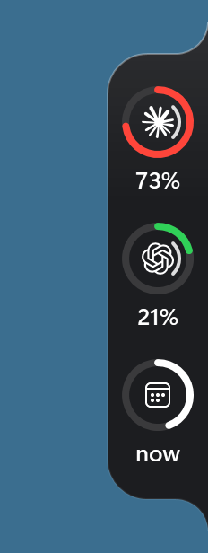 | 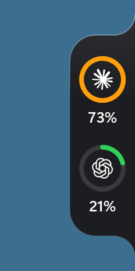 |

### Hover a ring

- **Claude:** every limit and when it resets, with its pace (see [Pace](#pace)), then your live Claude Code sessions.
  Each shows:
  - the start of your last prompt and what Claude did last ("“fix the auth bug…” · Edited middleware.ts");
  - its model and tokens so far, how full its context window is, and how long its prompt cache stays warm ("Opus 4.8
    · 1.2M tokens · ctx 64% · cache 41m").
  - The context is measured against the model's window (200K, or 1M for models that have it) and reads "high" in
    amber from 80%.
  - The cache time is an estimate, counted from the latest reply: an hour on a Claude plan, 5 minutes with an API key.
    Claude doesn't publish the exact expiry.
- **Codex:** every limit, then your latest Codex chat and its model. Once the chat records a token count, how full its
  context window is ("GPT-5 Codex · ctx 34%"), amber from 80%.
- **The panel's Claude and Codex tiles** show the same limit as "73% used", the window's name, when it resets, where
  the numbers came from and how old they are. Old Codex log snapshots, and cached numbers after a failed check, dim
  once they're over ten minutes old.

### Approve and answer Claude from the capsule

When Claude Code needs you while you're in another app, Claude's ring pulses amber. **Hover it**, and the card shows
what Claude is asking:

- **A command** ("Claude wants to run a command"): what it wants to run, and **Allow once**, **Always allow**, **Deny**
  or **Answer in Claude**. **Always allow** only appears when Claude Code itself suggests a rule that Capsule can show
  completely. Hover the command or **Always allow** to read its full text.
- **A question:** Claude's options as buttons (checkboxes when you can pick several), one question at a time, with
  **Other…** to type your own answer, then **Next** or **Send**.
- **A file edit** ("Claude wants to edit a file"): the file and the change line by line, what's taken out on red and
  what's put in on green. A new file shows all its lines. **Allow once**, **Allow all edits** (when Claude Code offers
  it), **Deny** or **Answer in Claude**.
- **A plan** ("Claude's plan is ready"): the plan with its headings, lists and code. **Approve plan**, or **Give
  feedback…** to type what to change, then **Keep planning** (or Enter) to send it to Claude.

| Approve a command | Answer a question |
|:---:|:---:|
| 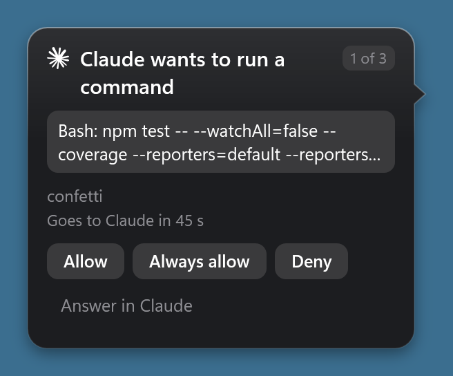 | 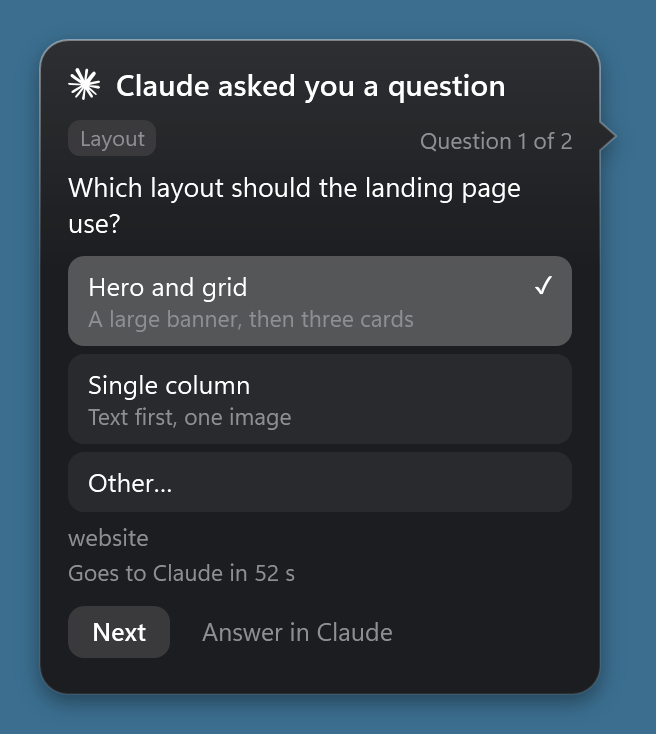 |

| Review an edit | Review a plan |
|:---:|:---:|
| 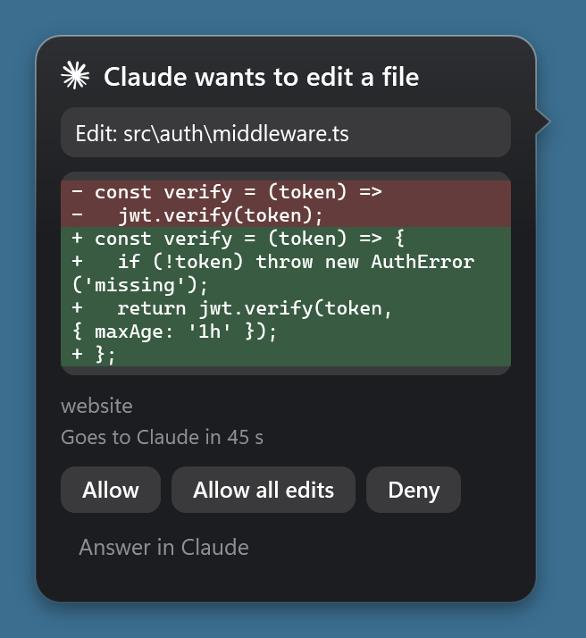 | 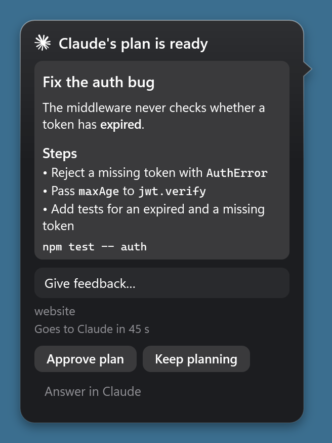 |

- **Everything is shown whole, or not at all.** An edit, file or plan over 20,000 characters, a command over 4,000,
  or anything with hidden control characters stays in Claude's own prompt, as do notebook edits and other tools.
- **Nothing gets stuck.** Untouched, a request goes to the Claude app after 60 s, as if Capsule weren't there. Using
  the card restarts that, but never past 80 s after the request arrived, because Claude Code's hook waits only 90 s.
- **It stays out of your way.** While the Claude app is in front, or the capsule is hidden, the app asks as usual.
  Capsule lets go as soon as the app's own prompt is answered.
- **Several requests** wait their turn, oldest first ("1 of 3").
- **The session turns to working** as soon as you answer.

#### Answer with the keyboard

Press **Ctrl+Alt+N** (the panel shortcut) while a request waits, and its card opens. **Tab** and **Shift+Tab** move
between the buttons, **Enter** presses the one with the focus ring, and **Esc** closes the card without answering.
Nothing is selected when the card opens, so Enter alone does nothing until you choose a button.

### Codex and local ChatGPT Work

1. Right-click Capsule and choose **Connect to Codex / Work**. Capsule copies the hook to
   `%USERPROFILE%\.capsule\bin` and adds it to `%USERPROFILE%\.codex\hooks.json` (or under `CODEX_HOME`), after a
   backup, keeping your other hooks.
2. Trust Capsule's two hooks in your host: the Codex CLI has `/hooks`. Trust the new path once after upgrading from an
   older Capsule. Until a request arrives, the menu reminds you: "No events yet: trust the hook in Codex (/hooks),
   then start a new chat".
3. Start a new local chat. While another app is in front, hover the amber Codex ring to respond.

If your Windows user folder contains `` % $ ` " & < > ( ) @ ^ | ``, Windows' `cmd` can't launch the hook from it.

Codex only asks when its permission mode lets it. On **Full access** it runs commands without asking, so nothing
reaches the capsule; choose **Auto** (or another mode that asks) next to the message box.

| Approve a Codex / Work command | Type a question answer |
|:---:|:---:|
| 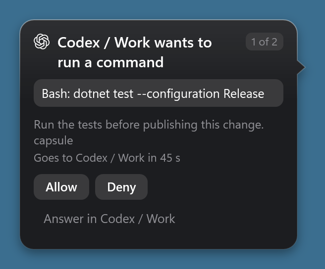 | 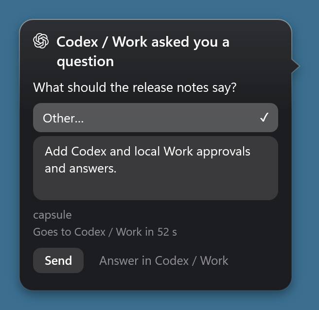 |

- The command card shows the full command, working folder and reason: **Allow once**, **Deny** or **Answer in Codex /
  Work**. There's no **Always allow** for Codex.
- Questions support options and typed answers, including free-text-only questions.
- Claude and Codex have separate queues, with the same 60-second fallback and 80-second limit. A hidden Capsule, a
  disconnected hook or a Codex / Work window in front leaves the request with the host.
- It needs a host with command hooks, and covers local chats only. Cloud Work, ordinary ChatGPT web chats, file
  edits, plans, wider permission grants, secret questions, and requests too big to preview stay in the host. See
  [OpenAI's hook documentation](https://learn.chatgpt.com/docs/hooks).
- **How it works:** command decisions use `PermissionRequest`, before the host's own approval reviewer. Question
  answers use `PreToolUse` feedback: Capsule skips the original question and sends your answers to the model, which
  continues from them. This doesn't create the host's own structured answer record; use **Answer in Codex / Work**
  when that matters.
- **Disconnect from Codex / Work** removes only Capsule's entries.

## Usage history and limit alerts

Click the **Claude** or **Codex** tile in the panel for the Usage page. ← or Esc goes back.

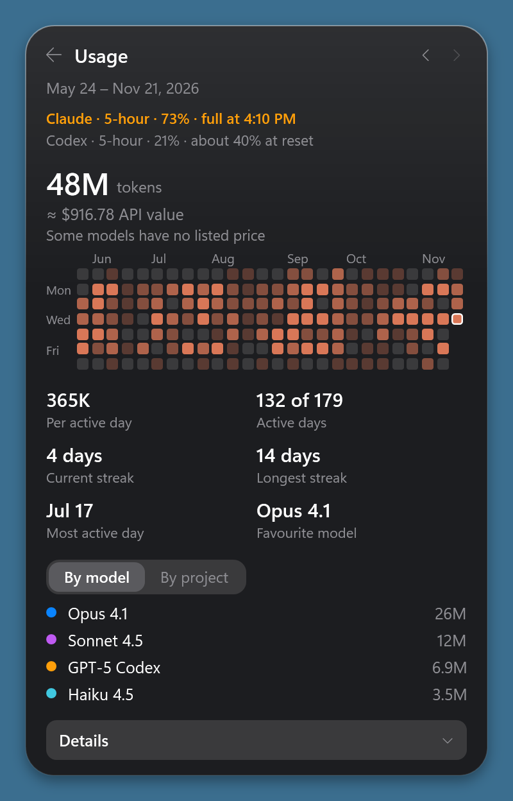

- **Pace lines** at the top: how each ring's limit is going, such as "Claude · 5-hour · 73% · full at 4:10 PM".
- **A heatmap** of the last 26 weeks: a square a day, a column a week, in four shades of orange by how busy the day
  was. Today is ringed. Hover a day for its tokens and biggest models or projects; ‹ › looks back another 26 weeks.
- **The figures** under it: tokens per active day, active days, your current and longest streak, your most active day
  and your favourite model.
- **Tokens without cache reads:** input, output and cache writes. Claude re-reads its cached context every turn,
  which would bury everything else, so **Details** shows cache reads apart, with the busiest day and the daily average.
- **By model / By project** changes the legend, day hover, and **Details**. Projects are ranked by tokens.
  Claude and Codex count together. Capsule can show projects only for logs it has read.
- **API value** estimates the USD value of the tokens at listed API prices. Hover the amount to see the split by
  model or project. Your plan is billed differently.
- **Where the numbers come from:** the logs Claude Code and Codex already write on this PC, archived Codex chats
  included. A turn copied into a forked chat counts once. Claude Code deletes its logs after 30 days, so the first
  launch counts the last 30 days or so; from then on Capsule keeps its own history. Claude Code inside the Claude
  desktop app keeps its logs where Capsule can't see them, so those sessions aren't counted.

### Pace

Capsule remembers each usage check and works out how fast each limit is rising: over the last hour for 5-hour limits,
the last day for weekly ones. After 15 minutes (2 hours for weekly limits) and a visible rise, the hover card says
"At this pace: full at 4:10 PM · locked 41 min" (amber, when you'd run out before the reset) or "about 64% at reset".
Until then it compares your use with an even spread: "81% of the window gone · 1.1× even pace", where 1.0× uses the
limit exactly as fast as the window runs out.

### Alerts

Windows notifications from Capsule's tray icon, each once per limit window. Click one to open the panel.
- "Claude's 5-hour limit is at 80%. It resets at 4:51 PM." (and again at 95%)
- "At this pace you'll hit Claude's 5-hour limit at 4:10 PM, 41 min before it resets." (from 30% used, once two checks
  in a row agree)
- "Claude's 5-hour limit has reset." (for a limit Capsule warned you about)
- "capsule is at 91% of its context. Claude Code will compact it soon." (once; again only after it drops under 80%)
- "capsule is waiting on you, and its prompt cache goes cold in about 5 min." (for a session waiting on you with an
  hour-long cache, once per reply. An answer after that re-reads the whole conversation.)

Untick **Limit alerts** in the menu to turn them off. While you focus, they wait for your break.

Turn on **Notify when long turns finish** in the menu to get a notice when a Claude Code turn takes at least five
minutes. Click it to open the panel. The switch starts off. During Focus or while Claude is in front, Capsule skips
the notice.

## The panel's tiles

### Google Calendar

With a calendar connected, the capsule gets a third cell:
- when your next event today starts ("2:30", or "14:30" with a 24-hour clock);
- **now** during an event, with its ring filling as it runs;
- **—** when nothing is left today. All-day, cancelled and declined events don't count.

Hover it for the rest of today and tomorrow's first three events, plus Google Tasks due those days when you're signed
in. The panel's Calendar tile shows the same.

| Hover the calendar | The month page |
|:---:|:---:|
| 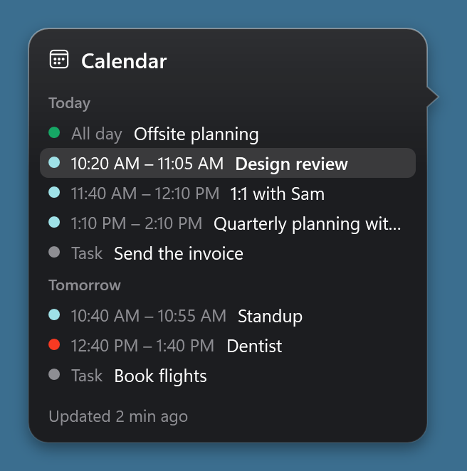 | 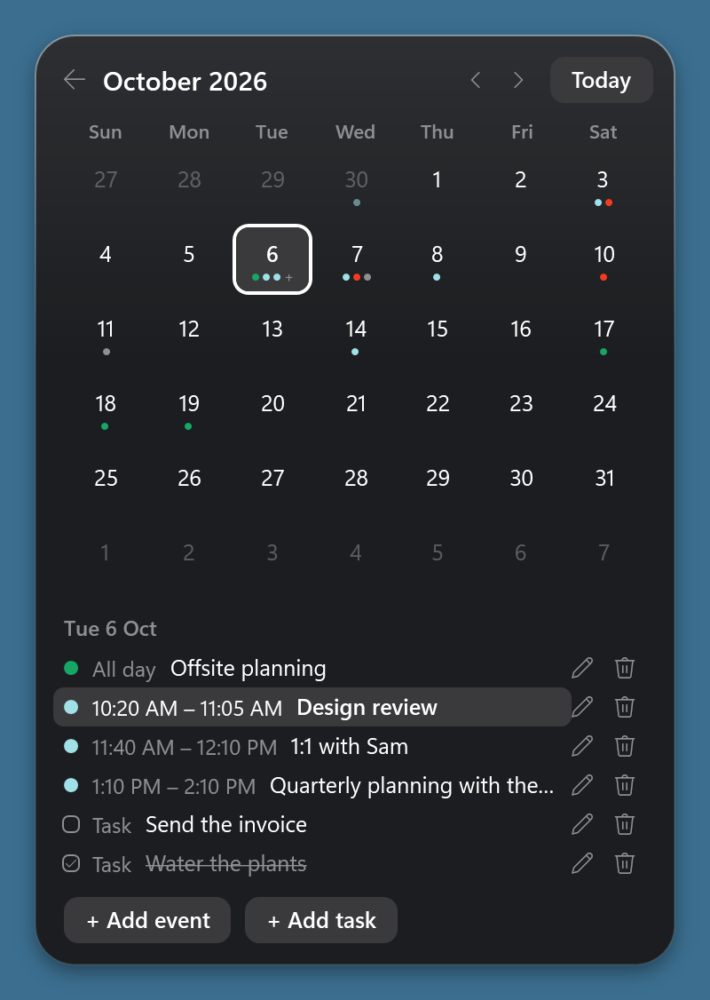 |

There are three ways to connect. The one-click sign-in isn't in a release yet, so use the link or your own client for
now.

**Sign in with Google (one click, coming in a later release).** In Settings, under **Google Calendar**, click **Sign in
with Google**, pick your account and allow access to your events, calendars and tasks. All your calendars show,
changes come within 5 minutes, and you can add, edit and delete from the [month page](#the-month-page).
- Until Google finishes reviewing Capsule, it warns that the app isn't verified: click **Advanced**, then **Go to
  Capsule**. Google also limits an app under review to 100 users; if you hit that, use one of the ways below.
- A build from source never has this button.

**The quick way: your calendar's secret link (read-only).**
1. In Settings, under **Google Calendar**, click **Get link**. Google Calendar's settings open in your browser.
2. Under **Settings for my calendars**, click your calendar, then **Integrate calendar**.
3. Copy **Secret address in iCal format** (not the public address). Capsule saves it the moment you copy it, and says
   so. For 5 minutes after **Get link**, it looks at what you copy for that one kind of address only, and the address
   never goes into clipboard history. Or paste it under **Calendar link** and click **Save link**.

- The link shows one calendar, your main one, with the events you're invited to. It's read-only: no tasks, and no
  adding, editing or deleting.
- Capsule reads it every 15 minutes; Google only refreshes the link's file every so often, so changes can take a while.
- Some work and school accounts have the secret address turned off. Use your own client then.
- Anyone with the link can read that calendar. Capsule keeps it encrypted and never shows it again. If it ever leaks,
  **Reset** it on the same page in Google Calendar and paste the new one.

**Your own Google client (sign in; several calendars).** About ten minutes, once. You sign in instead of pasting a
link, choose which calendars show, get changes within 5 minutes, and can add, edit and delete from the month page.

1. **A project.** In the [Google Cloud console](https://console.cloud.google.com/), create a project (call it Capsule).
2. **The APIs.** In **APIs & Services → Library**, enable **Google Calendar API** and **Google Tasks API**.
3. **The consent screen.** Open **Google Auth Platform** (formerly **OAuth consent screen**) and click **Get started**.
   Name the app Capsule, give your email, and choose the audience:
   - **Internal** for a Google Workspace (work or school) account. No review, and the sign-in doesn't expire on a
     schedule.
   - **External** for a personal Gmail account. Then, under **Audience**, click **Publish app** so it's **In
     production**. While it stays in **Testing**, Google ends the sign-in every 7 days.
   - **Publish app greyed out?** Google first wants, on the **Branding** page, an app name, a support email, a
     developer contact, and an **Application home page** and **privacy policy link** on an **Authorized domain**. Any
     page of your own works, such as a free GitHub Pages site: this repo's `docs` folder has a home page and a privacy
     policy you can copy. Don't upload a logo: that makes Google require a review first.
   - **"Access blocked: Capsule can only be used within its organization" (Error 403: org_internal)** means the
     audience is Internal but you signed in with an outside account, such as Gmail. Under **Audience**, click **Make
     external**, then **Publish app**, and sign in again. If **Make external** isn't offered, the project belongs to a
     Workspace organization: create it again signed in with your Gmail account.
4. **The permissions.** Under **Data Access**, click **Add or remove scopes** and add these three, then **Save**:
   - `.../auth/calendar.events` (see and add events)
   - `.../auth/calendar.calendarlist.readonly` (your list of calendars, read-only)
   - `.../auth/tasks` (see, add and tick your tasks)

   If one isn't listed, paste its full name, such as `https://www.googleapis.com/auth/tasks`, into **Manually add
   scopes**.
5. **The client.** Under **Clients**, click **Create client**, choose **Desktop app**, name it Capsule, and click
   **Create**. Google shows the **Client secret** only now: click **Download JSON**, open the file in Notepad, and copy
   all of it. Lost the secret? Open the client, click **Add secret**, and copy the new one straight away. Once Capsule
   is signed in with it, disable and delete the old one.
6. **In Capsule:** open Settings, click **Use your own Google client instead** under **Google Calendar**, paste the
   whole JSON into **Client ID** (it fills in both boxes), and click **Sign in with Google**. Allow the permissions in
   your browser. With an External app, Google first warns that it hasn't verified the app; it's your own app, so click
   **Advanced**, then **Go to Capsule**. The page then says Capsule is signed in. If clicking away closed the panel,
   what you pasted is kept: open ⚙ again and carry on.

Then Settings shows your account and a box for each calendar: the ones you show in Google Calendar start ticked.
**Change client** signs in with another client; **Sign out** forgets the sign-in, asks Google to revoke it, and a saved
link takes over again. Signed in before adding existed? Add the permissions in step 4 (and the Tasks API, step 2), then
click **Sign in again**.

**Either way,** Capsule reads your calendar every 5 minutes signed in, or every 15 with the link, and also when the
panel opens, after the PC wakes and when the network comes back. If Google can't be reached, it keeps the last list,
dimmed after 15 minutes. If Google ends the sign-in, a balloon says so and **Sign in with Google** comes back.

#### The month page

Click the calendar button at the top right of the Calendar tile.

| + Add event | Delete, asked first |
|:---:|:---:|
| 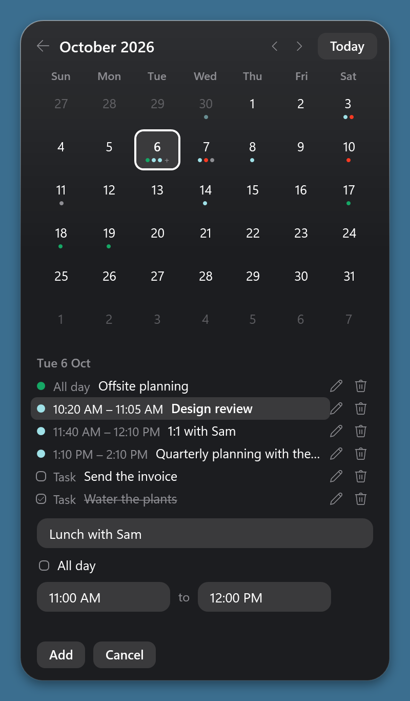 | 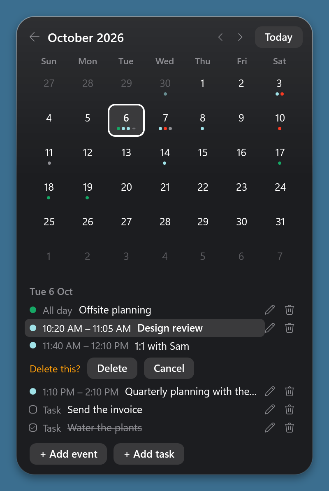 |

- **The month:** six weeks, with a dot per event in its calendar's colour and a grey one per task; **+** means more
  than three. ‹ and › change the month, **Today** comes back, ← returns to the tiles.
- **A day:** click it for its events, all-day first, then its tasks. Tick a task to mark it done in Google Tasks.
- **+ Add event:** a title, then **All day** or a start and end time ("2:30 PM", "14:30" and "2pm" all work), and the
  calendar if you can add to more than one.
- **+ Add task:** a title, and the list if you have more than one. It's due that day.
- **Edit or delete:** hover one of your own events or tasks for a pencil and a bin.
  - The pencil opens the form filled in; change it and click **Save**. A multi-day event can only be deleted here.
  - The bin asks **Delete this?** first. Nothing is deleted until you click **Delete**.
  - For a repeating event, both change only that day's one. If the event has guests, Google emails them.
  - Events you were invited to, and read-only calendars such as holidays, have no buttons.
- Adding, ticking, editing and deleting need a sign-in; with the link, the page only shows events.
- **Keys:** ← → move a day, ↑ ↓ a week, Page Up / Page Down a month. In the form, Enter saves and Esc cancels. Esc
  also cancels **Delete this?**, and otherwise closes the panel.
- If the page asks you to turn on the Google Tasks API, enable it in your Cloud project (step 2 above). Tasks show up
  at the next read.

### Weather

Weather starts off. In Settings, enter a place under **Weather**, click **Find** and select a match. The tile shows
current conditions, the next six hours and the next four days, in **Automatic** (your Windows region), **°C** or
**°F**. Times use the place's time zone and your Windows clock format.

Capsule refreshes every 30 minutes, after the PC wakes or reconnects, and when you open the panel with a forecast
older than 15 minutes. A failed update keeps the last forecast, dimmed after 90 minutes. **Turn off** clears the place
and stops requests.

[Weather data by Open-Meteo.com](https://open-meteo.com/) · [CC BY 4.0](https://creativecommons.org/licenses/by/4.0/)

### Spotify and YouTube Music

Start a song in Spotify or YouTube Music, and a **Music** cell appears on the capsule. Hover it for the artwork,
title, artist, progress, and **Previous**, **Play / Pause** and **Next**. The panel's Music tile has the same, plus a
volume slider. No sign-in or API key is needed.

| The Music cell | Hover it |
|:---:|:---:|
| 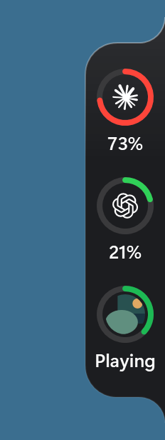 | 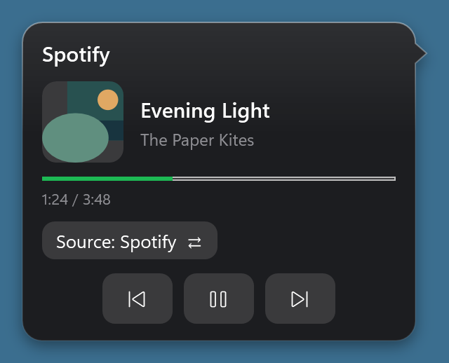 |

- The cell stays for 2 minutes after you pause, so Play is still in reach. The panel's tile is always there.
- **Volume:** the speaker button mutes the default Windows playback device, and the slider sets its volume. The mouse
  wheel and arrow keys move it by 2, Page Up / Page Down by 10. It follows changes made in Windows.
- Spotify's desktop app and anything that uses Windows media controls is found automatically. YouTube Music in Chrome,
  Edge, Firefox and other browsers shows under the **browser's name**; Windows doesn't give the tab's address, so other
  media tabs can appear too. With several players, click **Source** to switch.
- It controls playback **on this PC** only: no library browsing, other devices or seeking. A player that doesn't
  publish Windows media information can't be shown.
- Needs Windows 10 version 1809 or later.

### Focus timer

| The Focus ring | Focus and Clipboard tiles | Choose your rings |
|:---:|:---:|:---:|
| 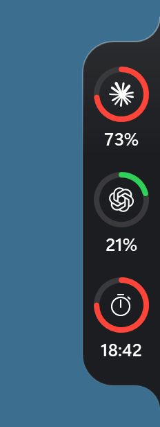 | 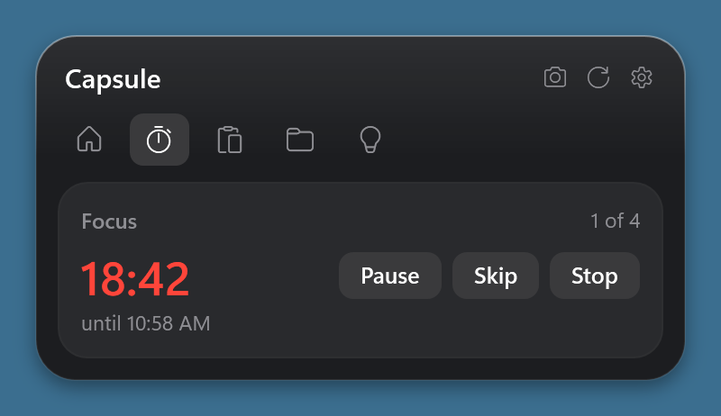 | 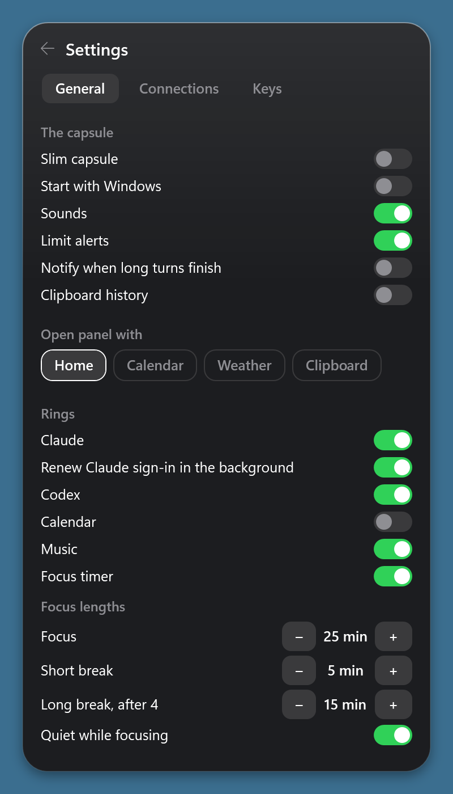 |

Click **Start** on the Focus tile, or **Start focus** in the menu: 25 minutes of focus, a 5-minute break, and a
15-minute break after every four. A Focus ring counts down on the capsule, red while you focus, green on a break and
dimmed while paused. A sound and a notification mark the end of each part. **Pause**, **Skip** and **Stop** are on the
tile and on the ring's hover card; the lengths are in Settings. The timer picks up where it was when Capsule restarts.

**Quiet while focusing:** Capsule's own chimes and alerts wait for the break, then come as one note, such as "While you
focused: 2 requests needed you, 1 session finished." The rings still glow and spin. Turn it off in Settings, under the
focus lengths.

### Clipboard history

Off until you turn it on in Settings, under **Clipboard history**. The Clipboard tile then lists your last 25 copies,
newest first, filtered by **All**, **Links**, **Images**, **Code** or **Text**. Colours such as `#30D158` show a
swatch, code shows its first line in monospace, links show the host and path without the query, and up to 5 images
have thumbnails. Click a row to copy it again ("Copied" confirms it), or **Clear** to empty the list.

### Screenshots and scrolling webpages

Click the camera in the panel, choose **Capture...** in the menu, or press **Ctrl+Alt+S** (change it under **Capture
shortcut** in Settings).

1. Choose **Screenshot** for an area, **Scrolling webpage** for a whole page in Chrome or Edge, or **Copy text** to
   copy the words in an area.
2. Drag over the area. For a webpage, drag over the page itself, down to the bottom of the browser window.
3. For a webpage, keep the pointer over the page while it scrolls; moving it away pauses. **Stop** keeps what's
   captured so far; **Esc** or **Cancel** throws it away.
4. Check the preview. To crop, click **Crop**, drag over the area and press Enter.
5. Choose **Copy**, **Save PNG**, **Copy text** or **Keep on shelf**. **Retake** starts again.

**Copy text** skips the preview: drag over the area and its text is on the clipboard, one line per line. It uses
Windows' own text recognition, offline, in your Windows display languages. If Windows has none installed, Capsule
says how to add one.

- A scrolling capture goes to the top of the page first, then scrolls to the end, joining the screenshots where they
  overlap. A fixed header or footer appears once. If the top is too far to reach in time, the image starts where the
  page was, and the preview says so.
- Capsule can't tell the real end of a page from one that stopped scrolling, and stops early at content that changes
  as it scrolls (a video, an animation) or repeats too exactly to match. The preview says how it ended; check the
  joins at **100%**.
- Switching windows, or moving, resizing or closing the browser, cancels it.
- Limits: one capture at a time, 32,000 rows, 32 million pixels, 120 screenshots and 90 seconds, on one monitor, at the
  page's current width and zoom.

### Shelf

1. Drag files from File Explorer over the capsule to open the panel.
2. Drop them on the **Shelf** tile, which lights up with "Drop to add". Capsule keeps references to the originals.
3. Drag a row, or **Drag all files**, into another app, which gets a copy. Windows can block drops into apps running as
   administrator.

The shelf holds up to 12 entries and clears when Capsule exits. **Keep on shelf** in a capture's preview adds a PNG
(up to 12 captures and 64 MiB per session), which Capsule deletes on exit. One left behind by a crash is cleaned up
after a day.

### Needs you

The **Needs you** tile lists the oldest request from each agent, with the project, kind and wait time, and how many
more are queued. Click **Review** to open its card.

It can also watch one public GitHub repository for failing checks. In Settings, enter it as `owner/repo` or paste its
link, and click **Save repository** (checks start off).
- Capsule checks without signing in, so private repositories aren't supported.
- Up to 30 open pull requests and 30 recent workflow runs per scan, at least three minutes apart.
- It shows failures for each PR's latest commit, including timeouts and runs that failed to start. Cancelled runs and
  ones awaiting approval aren't failures. Click **Open run** to see one on GitHub.
- The tile says when results are incomplete and when the last check succeeded. **Turn off** stops the checks.

### Ideas → Notion

Ideas go into a Notion database of your choice, one page per idea, with the idea as its title.

1. In Notion's developer portal, [app.notion.com/developers/connections](https://app.notion.com/developers/connections),
   click **New connection** (you need to own the workspace). Name it Capsule, keep **API token**, and click **Create
   connection**. On its **Configuration** tab, Capsule needs only **Read content** and **Insert content**: untick
   **Update content** and choose **No user information**. Copy the **API token**: it's the secret Capsule asks for.
2. In Capsule's Settings, paste the token as the secret and click **Save and test**.
3. Open your database in Notion (or make one), then **••• → Connections** and add Capsule. Copy its link with
   **••• → Copy link**.
4. Open Settings again, paste the link, and click **Save and test**. It shows the database's name when both work.

It's two trips on purpose: clicking away closes the panel, and a secret pasted but not saved is gone. Once saved, the
secret stays.

Until setup is done, and whenever Notion can't be reached, your ideas wait in Capsule and go in the order you typed
them. Click an idea in the panel to open it in Notion. Capsule keeps every idea until Notion confirms it; one that
can't be written to disk yet stays in memory and is retried, and the tile says so. A queue file Capsule can't read is
kept as `ideas-queue.json.unreadable-<time>`. Very rarely an idea reaches Notion twice, for example when Notion's reply
was lost.

## What it reads, and where it connects

| Tool | Reads | Connects to |
|---|---|---|
| Claude | the Claude CLI's sign-in, `~/.claude/.credentials.json` | `api.anthropic.com/api/oauth/usage` |
| Codex | Codex's sign-in, `~/.codex/auth.json` (or under `%CODEX_HOME%`), or the usage Codex writes to its session logs; and the end of recent session logs, to see whether a turn is running | `chatgpt.com/backend-api/wham/usage` |
| Ideas | the Notion secret you saved | `api.notion.com`, once set up |
| GitHub checks | public pull request and Actions data, no sign-in | `api.github.com`, once you save a repository |
| Music | local Windows media sessions: track, artwork, playback state, controls and timeline | nothing; commands go only to the local player |
| Volume | the default playback device's volume and mute | nothing |
| Microphone | whether the default microphones are muted | nothing |
| Copy text | the area you drag over, read by Windows' text recognition on this PC | nothing |
| Ask Claude | the prompt you type, handed to the Claude app as a `claude://` link; never logged or kept | nothing; the Claude app opens it |
| Updates (downloaded copies only) | nothing | `api.github.com`: the latest release's version number, once a day |
| Google Calendar | the link, or the sign-in and client secret, you saved | with the link: `calendar.google.com` (the calendar's file); signed in: `oauth2.googleapis.com` (sign-in, renewing it, sign-out), `www.googleapis.com` (your calendar list and events, and adding, changing or deleting one) and `tasks.googleapis.com` (your tasks, and adding, ticking, renaming or deleting one) |
| Weather | the place name you search for and the saved place label, coordinates rounded to two decimals, and units | `geocoding-api.open-meteo.com` (your query and UI language when you click Find), `api.open-meteo.com` (rounded latitude and longitude and temperature unit, only once you select a place) |

Your browser handles Google's sign-in page, `accounts.google.com`; Capsule only opens it. Capsule doesn't follow
redirects, so a request can't end up anywhere else.

**Secrets.**
- Claude and Codex sign-in tokens and Google's short-lived access tokens stay in memory. They're never logged, shown
  or saved.
- The Notion secret, the calendar link, the Google sign-in (a refresh token) and your client secret are encrypted for
  your Windows account (DPAPI), sent only to their own service, and never logged or shown, not even in Settings once
  saved.

**Claude Code and Codex.**
- When Claude Code or Codex asks for a permission, the hook hands the request to Capsule over a local pipe only your
  Windows account can open, and waits up to 90 s. Commands, file edits, plans, questions and your answers are shown on
  the card only, held in memory, and never logged or saved. Your plan feedback goes only to Claude.
- **Always allow** applies exactly the rule Claude Code suggested, as the app's own button does. Capsule writes no
  permission rules itself and never sends Codex an Always allow.
- Capsule reads `~/.claude/settings.json` every 5 seconds to see whether its hook is connected, and changes it, or
  `~/.codex/hooks.json`, only when you choose Connect, Reconnect or Disconnect.
- For each Claude Code session, the hook records its id and state and when that began; the last event's name and
  time; the project folder's name; while it waits on you, a short reason ("needs permission: Bash", or up to 80
  characters of Claude Code's own notification); and for the row, the start of your last prompt (up to 120 characters)
  and what Claude did last, by a file's name or a command's own short description ("Edited middleware.ts"). It never
  records a folder path, file contents, a command's text, or anything Claude reads or writes. The file is deleted when
  the session ends, and nothing in it goes into Capsule's log.
- Each session's model and tokens come from its own log in `~/.claude/projects`, read only when it has news, and kept
  in memory.
- Capsule reads the end of Codex's recent session logs every couple of seconds to see when a turn starts and ends,
  and scans Codex's day folders every 15 seconds for logs written recently. Nothing from them is kept, shown or logged.
- **Usage history** reads only what's new in Claude Code's and Codex's logs every 5 minutes, and keeps the model, the
  time and the token counts per day in `usage-history.json`. It keeps project folder names and token breakdowns on
  this PC in `usage-detail.json` to show usage by project. It never stores full paths, prompts, replies, or tool
  inputs and outputs in either store. Project names are never logged or sent anywhere. Each log is known only by a hash.
- To renew an expiring sign-in, Capsule can run `claude -p` with no input, which may start your Claude Code hooks,
  plugins and MCP servers. Turn off **Renew Claude sign-in in the background** in Settings to stop it; then open Claude
  Code when your sign-in expires.

**Everything else.**
- **Google Calendar:** with the link, Capsule only reads. Signed in, it reads your events, calendars and tasks due in
  the days shown, and changes something only when you ask on the month page. It never touches events you were invited
  to. Titles and names are shown only, held in memory, and never logged; what you type into the month page's forms goes
  only to Google; the log has counts only, such as "calendar: 7 events from 2 calendars"; `config.json` keeps your
  client's ID and the ids of the calendars whose box you changed. To come back from the browser, Capsule listens on `127.0.0.1` for that one sign-in, for up
  to 5 minutes.
- **Ideas'** text is never logged. It's kept in `ideas-queue.json` while it waits, in `ideas-discarded.json` if Notion
  refused it and you discarded it, and in Notion. Notion is asked only for the database's name and title column, to add
  an idea, and for your five newest ideas.
- **Clipboard history** is in memory only: never saved or logged, and gone when Capsule quits. Windows tells Capsule
  when the clipboard changes; nothing is polled. Copies an app marks as private (password managers do) are skipped,
  files are never kept, and turning it off clears the list.
- **Captures** read only the area you select and stay in memory until you close the preview. **Copy** changes the
  clipboard, **Save PNG** writes where you choose, and **Keep on shelf** stages a PNG in the Windows temporary folder.
  Capsule never logs or uploads them.
- **Shelf** keeps file paths in memory and gives them only to the app you drop them on. It leaves your original files
  in place and removes its own staged PNGs on exit.
- **Music** metadata stays in memory. Capsule saves no listening history and never contacts Spotify or YouTube.
- The **update check** sends nothing about you. A Capsule you built yourself never checks.

**Capsule's own files** are in `%USERPROFILE%\.capsule\`: settings (`config.json`), the last readings, session status
files, usage history and samples, the encrypted secrets, the ideas queue, the focus timer, the staged hook in `bin`,
and a log. They're deliberately not under AppData: the Claude desktop app runs Claude Code, and so the hook, inside a
Windows app package, and Windows would redirect AppData writes from there to a private copy Capsule can't see.

## Update

- **Scoop:** when Capsule shows an update, select the notice to copy `scoop update capsule`, and run it in a terminal.
  The bucket gets each release within a few hours.
- **winget:** `winget upgrade vorgtrom.Capsule`.
- **Downloaded:** once a day Capsule checks for a newer release. When there is one, a balloon says so and the menu's
  first item reads **Capsule v1.11.0 is available…**; choose it for the release page. Quit Capsule, unzip the new zip
  over the same folder, and start `Capsule.exe`. To stop the check, untick **Check for updates**.
- **Built from source:**
  1. `git checkout main`, then `git pull`. (To try a change that isn't merged yet: `git fetch origin`, then
     `git checkout <its branch>`.)
  2. Optionally, run `build.cmd dev` first. It builds into `bin-dev\` and runs the tests while your Capsule keeps
     running. If it says `BUILD FAILED`, stop here: your Capsule is untouched.
  3. Run `build.cmd`. It quits the running Capsule, builds into `bin\` and runs the tests. If it says `BUILD FAILED`,
     go back with `git checkout main` and run `build.cmd` again.
  4. Start `bin\Capsule.exe`.

Your settings, sign-ins and ideas live in `%USERPROFILE%\.capsule\` and carry over. Capsule refreshes its staged hook
when it starts.

## Uninstall

1. Disconnect Claude Code and Codex / Work in the menu if you connected them.
2. Untick **Start with Windows**, then **Quit Capsule**.
3. Delete Capsule's folder, or run `scoop uninstall capsule` or `winget uninstall vorgtrom.Capsule`. Then delete
   `%USERPROFILE%\.capsule\`, including its `bin` folder.
4. Optionally, delete the backups Connect left: `~/.claude/settings.json.capsule-bak-*` (older ones are
   `usage-notch-bak-*`) and `~/.codex/hooks.json.capsule-bak-*`.
5. If you set up Ideas, delete the Capsule connection in Notion's developer portal.
6. If you connected Google Calendar: **Sign out** (or **Remove link**) in Settings first. Optionally **Reset** the
   secret address in Google Calendar, and delete your Capsule project in the Google Cloud console. While Capsule has
   access, your Google Account lists it under **Security → Your connections to third-party apps & services**.

## Build

`build.cmd` compiles `bin\Capsule.exe`, `bin\capsule-hook.exe` and `bin\Tests.exe` with
`%WINDIR%\Microsoft.NET\Framework64\v4.0.30319\csc.exe`, stops a running copy, and runs the tests. `build.cmd dev`
builds into `bin-dev\` instead and leaves a running Capsule alone; only one Capsule runs at a time, so it's for tests
and `--preview`, not a second copy. `bin\Tests.exe --groups` shows how many checks each group ran.

GitHub builds and tests every pull request and every change to `main` the same way, on Windows.

**Publish a release:**
1. In [CHANGELOG.md](CHANGELOG.md), rename **Unreleased** to the new version (such as `## v1.11.0`), and add a fresh
   **Unreleased** above it. Merge that to `main`.
2. On GitHub, open **Actions → Release → Run workflow** and enter the same version.

GitHub builds Capsule, runs every test, and publishes `Capsule-<version>.zip` with its SHA-256 and that version's
notes. Downloaded copies hear about it within a day.

## License

MIT: see [LICENSE](LICENSE). You may use, change and share Capsule, keeping the copyright notice.

## Credits

The provider marks are from [@lobehub/icons](https://github.com/lobehub/lobe-icons) (MIT). They are trademarks of
Anthropic and OpenAI.

Capsule was called UsageNotch until 2026-10-01.
